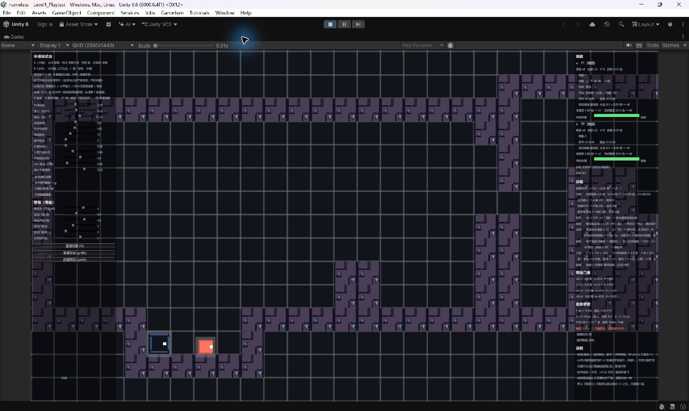
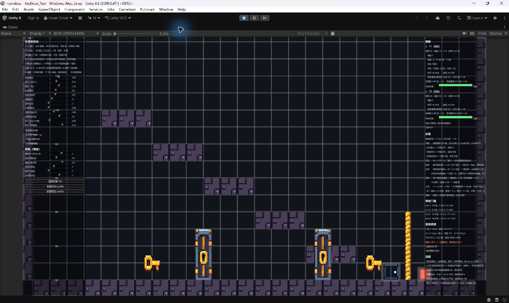
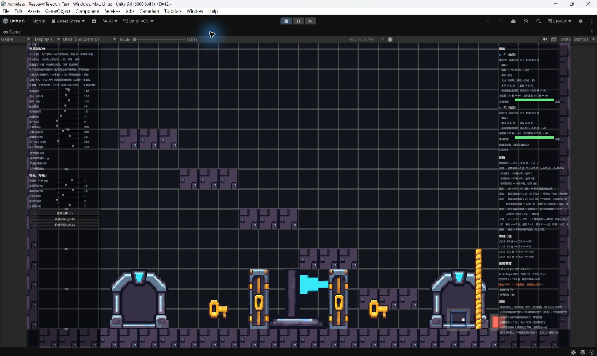

# Issue #26 选定美术接入验证

环境：Windows，Unity 6000.6.4f1，主分支基线 `df806c6`，2026-11-06。

用户选择第一组工业场景物件、第二组几何人物。素材、来源说明及导入规则见 `Project/nameless/Assets/TuningLab/Art/README.md`。

## 自动检查

- Unity 导入与脚本编译完成，无编译错误。
- 原生 PNG 检查：24 张，44 种不透明颜色，alpha 仅 0/255。
- `LabArtSceneCheck.RunBatch`：24 张素材、7 个正式场景、312 个使用共用显示层的预览物件通过。竖绳保持每格一个原渲染器，直接使用贴图，不计入显示层组件数量。本地 `Level1_Playtest` 是用户的试玩副本，不纳入提交。
- `LabLevelSelfCheck.RunBatch`：全部通过。
- 完整 PlayMode：150 项，146 通过、3 失败、1 跳过。新增 `LabArtTests` 的门开关/重置/显隐、合并地形平铺尺寸检查通过；竖绳尺寸检查通过。

## 已有的玩法测试失败

以下三项与此前本机测试记录的失败名称和值相同，未修改规则代码来使测试变绿：

| 测试 | 结果 |
| --- | --- |
| `LabCannonTests.ConverterLoadsFromOneOpeningAndAutoFiresThroughTheOther` | 等待装填/发射条件超时：3 秒 / 151 个物理步 |
| `LabRespawnPointTests.BothDeathsRespawnTogetherAtFixedSlots` | 期望 y=5，实际 4.5785956 |
| `LabRespawnPointTests.BothDeathsWithoutCheckpointRespawnAtSpawn` | 期望 y=0.4375，实际 0.4524625 |

`RealKeysDashInThenFireKeepsSpeed` 在无窗口测试中跳过。

## 编辑器运行画面

实际打开并进入 Play：Level1 试玩副本、`KeyDoor_Test`、`RespawnTeleport_Test`。确认人物、逐格地形、钥匙、门、绳、传送门和重生旗可见。以下是未修改的 Unity 编辑器截图；调试 HUD 和网格保持原项目设置。

本次接入没有改动 `LabPlayer`、`LabForms`、碰撞尺寸、关卡数据或用户本地试玩场景。Issue #26 中的热一、旧地面绳和旧岩浆规则已落后于当前基线，本次按现有规则显示；背景、HUD 和未实现机制不在此次选定素材接入范围内。
