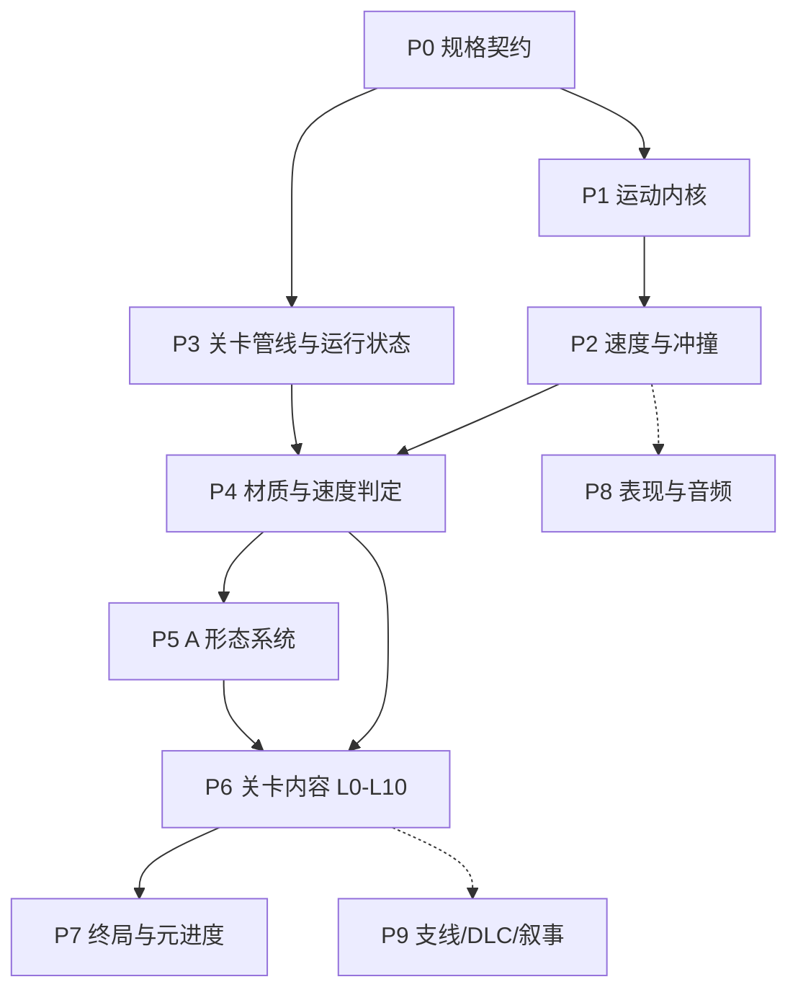

# 回 · 实现分层与阶段拆分

> 依据：[概述](./回-概述.md)、[机制](./回-机制.md)、[关卡](./回-关卡(未完成).md)
> 目的：按依赖把策划案拆成可独立验收的实现阶段；每个阶段结束都有一个能上手玩的切片。
> 原则：下层不依赖上层；机关只查询“速度等级”和“碰撞事件”，不反向驱动玩家。

## 状态

| 阶段 | 状态 |
| --- | --- |
| P0 规格契约 | 核心决策已落地：见 [ADR-0001](../adr/0001-world-scale.md)、[ADR-0002](../adr/0002-speed-model.md)、[ADR-0003](../adr/0003-level-topology.md) |
| P1 运动内核 | 已实现，待 Unity 内按手感验收 |
| P2 及以后 | 未开始 |

## 0. 结论

整个项目的依赖根只有三个：

1. **运动内核**（走、跳、四向冲刺）——已有雏形，缺冲刺。
2. **速度等级 + 碰撞冲撞**——绳子、冰块、热锻、大炮、门、L10 全部读它，必须最早做。
3. **关卡管线 + 运行状态**——没有它，L0–L10 无法落地，钥匙/传送门/L10 状态也无处存。

A 的六种形态是“上层消费者”，排在材质判定之后；L0–L10 内容再排在形态之后；表现、剧情、DLC 最后。

### 策划案本身的分层

| 层 | 内容 | 文档位置 | 实现阶段 |
| --- | --- | --- | --- |
| 定义层 | 世界尺度、速度档、输入、材质判定表 | [机制](./回-机制.md) 第 3 节 + 本文件 P0 | P0 |
| 规则层 | 移动、冲刺、碰撞、绳、冰、钥匙、门、传送门 | [机制](./回-机制.md) 第 1–2 节 | P1–P4 |
| 形态层 | A 的 `u`/`L`/`_`/`\|`/空、热锻 | [机制](./回-机制.md) 第 2 节 | P5 |
| 内容层 | L0–L10、支线、DLC | [关卡](./回-关卡(未完成).md) | P6/P7/P9 |
| 表现层 | 美术、音频、剧情 | [美学](./回-美学.md)、[剧情](./回-剧情.md) | P8/P9 |

## 1. 依赖图

关键路径：**P0 → P1 → P2 → P4 → P5 → P6 → P7**。

P3 可以和 P2 并行（只要 P0 的尺度和关卡拓扑定了）；P8 从 P2 起持续挂接；P9 最后。

## 2. 阶段总览

| 阶段 | 产出 | 硬依赖 | 可并行 | 量级 |
| --- | --- | --- | --- | --- |
| P0 规格契约 | 尺度、输入、速度模型、交互契约、调试 HUD | 无 | 美术风格、剧情 | S |
| P1 运动内核 | 四向冲刺、冷却、测距 | P0 | 关卡灰盒 | M |
| P2 速度与冲撞 | 挡位状态、碰撞传递、受击反馈 | P1 | 音效 | M |
| P3 关卡管线与状态 | Tilemap、出生点、相机、死亡重生、RunState | P0 | 美术 | M |
| P4 材质与判定 | 绳、冰、墙、门、钥匙、传送门、伤害 | P2、P3 | 关卡灰盒 | L |
| P5 A 形态 | 附着、六形态、热锻 | P4 | 关卡灰盒 | L |
| P6 关卡内容 | L0–L10 + 支线 | P5 | 表现 | L |
| P7 终局 | 传送门计数、质量+1、隐藏墙、结局 | P6 | 表现 | M |
| P8 表现与音频 | 手感、特效、UI、音效 | 无硬依赖 | 全程 | M |
| P9 支线/DLC/叙事 | 钥匙实体化、Boss、做梦提示、剧情 | P6 | — | S |

量级是参考：S ≈ 0.5 人日，M ≈ 1–2 人日，L ≈ 3 人日以上。以实际 jam 时长为准。

### 机制依赖矩阵

| 机制 | 依赖 | 被谁使用 | 阶段 |
| --- | --- | --- | --- |
| 走、跳 | 输入、尺度 | 所有 | P1 |
| 冲刺 | 移动 | v1、上冲、横冲 | P1 |
| 速度等级 | 冲刺、碰撞、重力、绳、炮 | 绳、冰、热锻、大炮、L10 | P2 |
| 碰撞传递 | 等质量、速度等级 | 横碰、v2、热锻 | P2 |
| 死亡与重生 | 关卡状态 | 刺、岩浆、空形态、热锻重置 | P3 |
| 相机 | 双人位置 | L10 视野揭示 | P3/P7 |
| 绳子 | 速度等级 | A 的 `\|`、L6/L8 | P4 |
| 冰块 | 速度等级 | v2 破冰、热锻融冰、L3 | P4 |
| 钥匙 | 携带状态 | 门、传送门、重生点、空形态 | P4 |
| 传送门 | 钥匙、双人输入、关卡状态 | L4、L10 | P4/P7 |
| A 形态 | 附着、速度、绳、岩浆、钥匙 | L4/L6/L7/L8/L10 | P5 |
| 热锻 | 碰撞、冰、重生、B 进入 | 与冰/钥匙的复合关 | P5 |
| 过关门 | 质量+1 | L10 | P7 |
| 相机揭示 | 相机、关卡布局 | L10 | P7 |

---

## 3. 分阶段说明

### P0 · 规格契约（核心决策已落地）

**目标**：把后面所有阶段都会引用、且现在不统一的数值和接口定下来。这一阶段不产出玩法，但能避免 P1–P6 反复返工。

**要做**

1. **世界尺度（已定）**：`1 unit = 1 tile = 16 px`，PPU = 16。策划里的距离全部按 tile 理解：跳跃高度 2、跳远 3、横冲 3+1、横碰 3+2+1、上冲单人 6 / 组合 8。人物 13 px = 0.8125 unit。测试房已按这个尺度重建。
2. **输入表（已定）**：两人共用一个键盘，键位不冲突。
   - A（大块）：`A/D` 移动、`W/S` 上/下、`Space` 跳、`LeftShift` 冲刺。
   - B（小块）：`←/→` 移动、`↑/↓` 上/下、`RightAlt` 跳、`.` 冲刺。
   - A 的形态切换键仍待 P5 定；P1 不涉及。
3. **速度模型（已定）**：挡位是行为申请的状态，速度由挡位给出。冲刺 → v1，碰撞 → v2，重力 / 绳 / 炮 → v3，炮 +1 / 最大组合 → v4。保留 `SpeedTierProvider` 继承点，后续可以改成“速度推导挡位”的实现，但暂不提供。
4. **交互契约（P2 落地）**：定义 `ImpactInfo`（攻击方、受击方、接触法线、速度、tier、接触点）和统一的表面响应枚举（`Pass` / `Bounce` / `Break` / `Accelerate` / `Stick` / `Die`）。所有机关实现同一个接口，避免每关写一套 if。
5. **关卡拓扑（已定）**：jam 用单个连续场景，L0–L10 从左到右排布，状态直接存在场景对象里；传送门做捷径 + 收集。这样 L10“一路创烂之前的路”和相机揭示都成立，也不需要存档系统。
6. **调试工具（P1 已完成基础版）**：HUD 显示挡位、速度、grounded、冲刺冷却、跳跃/冲刺最远距离；`R` 重置。slow-mo、传送到指定关留给 P3。
7. **文档修正（已完成）**：机制/概述里指向 `回-内容.md` 的链接已改到实际的 `回-关卡(未完成).md`；文件名暂不改，避免和未完成状态冲突。

**不做**：具体关卡、美术、音效、剧情。

**验收**：尺度、输入、速度、拓扑已确认；HUD 能实时显示挡位/速度/冷却/最远距离；测试房里量得出 2 格跳高、3 格跳远、3+1 格横冲。

**产出**：`GameConstants.cs`、`SpeedTierProvider.cs`、`DebugHud.cs`；[ADR-0001](../adr/0001-world-scale.md)、[ADR-0002](../adr/0002-speed-model.md)、[ADR-0003](../adr/0003-level-topology.md)。

---

### P1 · 运动内核收口（已实现）

**目标**：把现有的走/跳扩展成策划要求的四向冲刺，并让距离可测量。

**要做**

- 四向冲刺：水平、上、下；不可斜冲；上下方向优先于左右。
- 下冲只能在空中；冲刺期间 `gravityScale = 0`；冲刺结束后自然落到 v1 速度带。
- 冷却：落地且不处于冲刺态时开始 0.5s 计时；空中不冷却。
- 上冲距离单独测量；留出单人 6 / 组合 8 的调参入口。
- 保留现有 coyote time、跳跃缓冲、可变跳跃高度、踩头起跳、被撞让出控制权；按新尺度重调参数。
- 状态机加 `Dash`（如果做驮带，再加 `Carry`）。

**不做**：速度等级效果、机关判定、A 形态。

**验收**：玩具房里两人都能四向冲刺；横向冲刺实测 3 格 + 1 格缓冲；冷却期内无法再冲；空中下冲、地面不能下冲；无斜冲；跳高 2 格、跳远 3 格（±10%）。以 HUD 的“最远 / 最高”读数为准；手感不对就调 `PlayerMotor` 的 serialized 参数。

**实现**：[PlayerMotor.cs](../../Project/nameless/Assets/Scripts/PlayerMotor.cs)、[GameConstants.cs](../../Project/nameless/Assets/Scripts/GameConstants.cs)、[SpeedTierProvider.cs](../../Project/nameless/Assets/Scripts/SpeedTierProvider.cs)、[DebugHud.cs](../../Project/nameless/Assets/Scripts/DebugHud.cs)；测试房由 [PrototypeSceneBuilder.cs](../../Project/nameless/Assets/Editor/PrototypeSceneBuilder.cs) 生成。

**风险**：冲刺期间被撞怎么处理？建议第一版允许被撞但保持冲刺方向，不要一上来做复杂优先级。

---

### P2 · 速度与冲撞

**目标**：建立“速度等级”这个公共语言，以及双人互撞的速度传递。

**要做**

- 实现 P0 定的 tier 推导和阈值：v0 走、v1 冲刺、v2 被撞、v3 重力/绳/炮、v4 炮+1/最大组合。
- 碰撞传递：等质量，沿接触法线交换/传递速度；被撞方短暂硬直只锁输入、不锁速度，替换现有 `controlLock` 的土办法。
- 抛 `ImpactInfo` 事件，供材质、热锻、震屏、音效消费。
- tier 的颜色/描边先做功能版（黄/红/蓝/紫），不用等最终美术。
- 接住“重力加速”和“弹力”的接口；大炮在 P5。

**不做**：具体材质规则（P4）、A 形态（P5）。

**验收**：B 冲刺撞 A，A 被推出去并进入红色 v2，滑行距离接近 3+2+1 格；A 在 v2 下能穿过临时测试竖绳；两人互撞不抖动、不抢控制；HUD 的 tier 与实际速度一致。

**风险**：碰撞手感是全局风险。如果两个人撞起来像两块砖，后面的关卡设计全部失效。建议先用“法线速度交换 + 0.1s 输入硬直”，不要上复杂动量。

---

### P3 · 关卡管线与运行状态

**目标**：让关卡可以被快速摆放、出生、死亡、重生，并让钥匙/传送门状态跨关保留。

**要做**

- 按 P0 的拓扑落地：单场景连续世界或分立场景。
- Tilemap + 网格吸附；关卡 prefab；出生点、检查点、关卡边界。
- 相机：双人中点跟随、水平/垂直跨度缩放、边界 clamp；给 L10 的“视野收缩揭示”留接口。
- 死亡/重生：刺、掉落、空形态共用；重生点复活队友。
- RunState：钥匙数、已点亮传送门、B 的质量、最近重生点。
- 调试：传送到 Lx、重置本关、显示 RunState。
- 关卡灰盒工作流：Unity Tilemap + prefab marker，不自制关卡编辑器。

**不做**：具体机关、Boss、磁盘存档。

**验收**：L0 灰盒从出生点跑到终点；掉刺死亡后在最近重生点复活；走到下一区域后钥匙/传送门状态保留；相机不越界、不晕。

**现有代码**：[CoopCamera.cs](../../Project/nameless/Assets/Scripts/CoopCamera.cs) 扩展 clamp 和 zoom 接口；[PrototypeSceneBuilder.cs](../../Project/nameless/Assets/Editor/PrototypeSceneBuilder.cs) 保留为玩具房，不再承担正式关卡生成。

**风险**：不要做通用关卡编辑器，Unity Tilemap 足够。连续 vs 分立必须在 P0 定，否则 RunState 和传送门会返工。

---

### P4 · 材质与速度判定

**目标**：把策划里的场景物件按统一接口实现，优先做主线前四关需要的。

**要做**

统一接口：`ISpeedReactive`，输入 `ImpactInfo`，输出 `Pass / Bounce(+1) / Break / Accelerate / Stick / Die`。

| 物件 | 规则 | 首关 | 实现要点 |
| --- | --- | --- | --- |
| 固体墙/地面 | 阻挡 | L0 | 现有 BoxCollider2D |
| 可破坏墙 | 按材质和 tier 破坏 | L1/L6 | Tilemap 逐格清除或 CompositeCollider2D 重建 |
| 过关门 | 得到质量后才可破 | L10 | 读 RunState |
| 重生点 | 接触复活队友，吞钥匙 | L1 | Trigger + 检查点 |
| 竖绳 | v2 穿过、v3/v4 反弹 +1；A 的 `\|` 可附着 | L2 | Trigger 区 + 手动反弹，不做实体碰撞 |
| 地面绳 | 可上不可下；v2 强行下；v3/v4 反弹 +1 | L2+ | `PlatformEffector2D` + tier 判定 |
| 冰面 | 低摩擦滑行；v2 破一整面；红热接触融一格 | L3 | `PhysicsMaterial2D` + 逐格破坏 |
| 刺 | 接触死亡，高度 < 0.5 | 未指定（L9 提到） | Trigger |
| 玉米糊 | 规则未定；建议非牛顿：慢则陷/伤，快则弹/实 | L2 | **规则未定，见阻塞项** |
| 岩浆 | 需 A 的 `_` 木筏通过 | 未指定 | Trigger + 形态判定 |
| 钥匙 | 头顶携带，被门/重生点吞 | L2 | 跟随点 + 消耗 |
| 传送门 | 靠近点亮；双人站入 + 同时按「下」；吞钥匙；计数 | L4 | Trigger + 双人输入 |

**建议顺序**：重生点/固体 → 钥匙+过关门 → 竖绳 → 冰 → 伤害 → 传送门。传送门依赖 P3 的 RunState，可以最后接。

**不做**：A 形态、终局、DLC 的钥匙实体化。

**验收**：L1–L3 灰盒可通；竖绳 v2 穿、v3 弹；冰面 v2 碎；钥匙能开过关门；刺死能重生；传送门能点亮并计数（传送效果 P7 接）。

**风险**：玉米糊没有任何操作规则，是 L2 的硬阻塞；钥匙经济（每关几把、被吞后去哪）也必须先定。

---

### P5 · A 形态系统

**目标**：实现大块的形态切换和附着关系。这是全项目最高风险层。

**要做**

1. **附着基础**：B 站/坐在 A 上（现有踩头只是地面检测，需要明确的携带关系）；B 进入 A（大炮、热锻后）；统一 `AttachPoint` 或父子关系，处理速度继承。
2. **形态控制器**：形态切换输入（P0 定）、每种形态的碰撞体、视觉、移动限制。
3. **按依赖顺序实现**：附着 → `u` 大炮 → `L` 转换器 → `|` 攀附 → `_` 木筏 → 空 → 热锻。`-` 不做。
4. **各形态规则**
   - `u`：记录 B 进入时的 tier；A 仍可移动/跳/冲；B 按冲刺射出，tier +1。
   - `L`：改变 B 的 v 方向；A 是否冻结未定，建议 A 仍可移动，只改 B。
   - `|`：绳附近按 W 附着，W/S 升降，离开绳解除。
   - `_`：岩浆上漂浮并承载 B。
   - 空：无碰撞、限时死亡、可穿墙拿钥匙。
5. **热锻**：A 的边框用四条 `EdgeCollider2D`；B 以 v2 撞边两次 → 红热；冰接触或重生重置；红热后 v1 撞断边 → 虚线视觉 + 该边对 B 单向开放（B > v1 可进入）；A 仍站立。

**不做**：`-` 形态、Boss。

**验收**：每个形态一个 10 秒测试房；热锻完整链路（B 撞两次 → 红热 → 冰/重生重置 → v1 破边 → B 进入 → 恢复）；`u` 的 +1 级可测；`L` 能把 v2 转向上；`|` 能沿绳升降；`_` 能过岩浆。

**风险**：A 从单 BoxCollider 改成多边/多边形后，会回归 P1/P2 的推挤、踩头、地面检测，必须重跑验收。热锻同时耦合冰、重生、B 进入三个系统，放最后做，先在隔离测试房验证。`u/L/|` 分别被 L7/L4/L6+L8+L10 使用，不能砍；可以砍的是 `-` 和空形态（空形态影响墙中钥匙，砍之前先确认）。

---

### P6 · 关卡内容 L0–L10

**目标**：把机制组装成关卡，每关只教一件事。

| 关卡 | 新增机制 | 依赖 |
| --- | --- | --- |
| L0 | 冲刺、跳跃 | P1 |
| L1 | 横碰、上冲、重生点 | P2/P4 |
| L2 | 过关门 + 钥匙、玉米糊、绳子 | P4 |
| L3 | 冰块、滑行、v2 破冰 | P4 |
| 绳进阶（L3–L4 之间） | v2 穿绳、下冲 | P4 |
| L4 | 转换器、第一个传送门、支线 | P5 `L` / P4 传送门 |
| L4+ | L 形通道、绳子复习 | P5/P4 |
| L5 | 滑道、凹凸地面 | P4/P5 |
| L6 | 竖绳 + 转换器竖直转横 + 反弹破墙 | P5 `\|`+`L` |
| L7 | 大炮 | P5 `u` |
| L8 | 竖绳 + `\|` 性质 | P5 `\|` |
| L9 | 待定（与地刺的交互？） | P6 拍板 |
| L10 | 全传送门、质量+1、隐藏墙、相机揭示 | P7 |

**做法**：每关三件事——灰盒布局、写出预期解、放检查点/用布局引导（不做文字教学）。灰盒可以在 P3 后并行铺，最终调参等 P5 完成。

**不做**：最终美术、剧情演出。

**验收**：从 L0 连打到 L10，每关的预期解成立，不靠调试键。

**风险**：11 关 + 支线对 jam 偏多。建议合并 L4/L4+/L5，砍 L9，保 L10。每关先做“一屏一机制”，不要一开始铺大图。

---

### P7 · 终局与元进度

**目标**：闭合主线。

**要做**

- 传送门计数；全部点亮后 L10 开启，开启后传送门关闭。
- B 质量 +1；所有过关门可破；最高速墙。
- 相机视野收缩，藏住最终关卡入口。
- 结局或 Boss 占位。
- 明确“一路创烂之前的路”是脚本破坏还是玩家可破坏；建议脚本化，避免做全局破坏系统。

**验收**：全流程通关；隐藏墙需要绳子 + `u` + `L` 组合达到 v4 才能破；相机限制能藏住终点。

**风险**：质量+1 的数值语义未定（翻倍还是 +1 单位），会影响破门判定。

---

### P8 · 表现与音频

**目标**：让同一段操作“看起来和听起来”对。

**要做**

- 手感：顿帧 2–4 帧、震屏、冲刺拖尾、tier 颜色、落地 squash、撞墙粒子。
- UI：钥匙数、传送门计数、当前形态、P1/P2 标识。
- 音频：冲刺、撞击、碎冰、开门、传送、死亡。
- 美术：几何可爱风，16 px 网格，人物 13 px。

**建议**：不要在最后才做。P2 就先上最小 tier 颜色和撞击反馈，否则碰撞手感无法验收。

**验收**：同一段操作，加反馈前后手感明显不同；tier 颜色一眼可辨。

---

### P9 · 支线/DLC/叙事

**目标**：非主线内容，全部可砍。

- 钥匙被 v1 上撞后实体化（DLC 规则）。
- Boss 战。
- 长时间卡关时小块做梦提示。
- 剧情、美学文档补全；剧情与机制的关联。

**验收**：可选；不影响主线通关。

---

## 4. 设计阻塞项（拍板清单）

以下问题不解决，对应阶段会直接卡住或返工。

| # | 问题 | 阻塞 | 建议默认值 | 拍板 |
| --- | --- | --- | --- | --- |
| 1 | 世界尺度未定，距离数字没有单位 | P0/P1/P6 | 已定：1 unit = 1 tile = 16 px，PPU 16 | 已定 |
| 2 | 跳跃/冲刺/形态切换键未定义 | P0/P1/P5 | 已定：A = WASD + Space + LShift；B = 方向键 + RightAlt + `.`；形态键待 P5 | 已定（形态键待 P5） |
| 3 | v3/v4 的获取方式写成同一句 | P2/P6 | 已定模型；v3 = 绳弹/重力终端/炮入口，v4 = 炮 +1/最大组合 | 模型已定，数值待 P2 |
| 4 | 关卡是连续世界还是分立场景 | P3/P7 | 已定：单场景连续世界 | 已定 |
| 5 | 传送门是传送还是纯收集；激活/关闭条件 | P3/P7 | 点亮=收集 + 传送捷径；双人下键激活；吞钥匙；全亮开 L10 | 方向已定，细节待 P3 |
| 6 | 钥匙经济：每关几把、被吞后去哪 | P4 | 每关 1 把；门/重生点消耗；实体化归 DLC | P0/P4 |
| 7 | 玉米糊（非牛顿流体）没有规则 | P4/L2 | 慢（<v1）陷/伤，快（≥v2）弹/实 | P0/P4 |
| 8 | A 形态如何选择（u/L/_/`\|`/空） | P5 | 建议数字键选形态；近绳/岩浆给上下文提示 | P5 |
| 9 | 热锻的触发方、边框语义、破边后碰撞 | P5 | B 以 v2 撞边两次 → 红热；冰/重生重置；v1 破边后该边对 B 单向开放 | P5 |
| 10 | 质量+1 的数值含义 | P7 | B 质量翻倍或 +1 单位；过关门可被 B 以 v2 破 | P7 |
| 11 | 大炮/木筏/转换器是否同时是独立场景物件 | P4/P5 | 即 A 的 `u`/`_`/`L` 形态；滚木、传送点需单独定义或砍 | P0 |
| 12 | L9 的机制未定 | P6 | 48h 版本直接砍掉 | P6 |
| 13 | 文档链接指向不存在的 `回-内容.md` | P0 | 已修到 `回-关卡(未完成).md` | 已修 |

---

## 5. 现有代码映射

| 现有 | 用途 | 阶段 | 处理 |
| --- | --- | --- | --- |
| [GameConstants.cs](../../Project/nameless/Assets/Scripts/GameConstants.cs) | 尺度、跳距、冲刺距离等规格常量 | P0/P1 | 新增；后续数值调整集中在这里 |
| [SpeedTierProvider.cs](../../Project/nameless/Assets/Scripts/SpeedTierProvider.cs) | v0–v4 挡位状态 → 目标速度 | P1/P2 | 新增；继承并重写 `Tick` 可换成速度推导挡位 |
| [DebugHud.cs](../../Project/nameless/Assets/Scripts/DebugHud.cs) | 挡位、速度、冷却、跳跃/冲刺测距 | P1 | 新增；P3 再加传送/关卡状态 |
| [PlayerMotor.cs](../../Project/nameless/Assets/Scripts/PlayerMotor.cs) | 走/跳/四向冲刺/地面/推挤/状态机 | P1/P2 | 已加冲刺和挡位接口；P2 加 `ImpactInfo` |
| [CoopCamera.cs](../../Project/nameless/Assets/Scripts/CoopCamera.cs) | 双人中点 + 缩放 | P3 | 已计入垂直跨度；P3 加边界 clamp |
| [PrototypeSceneBuilder.cs](../../Project/nameless/Assets/Editor/PrototypeSceneBuilder.cs) | 一键生成 16px 网格测试房 | P1–P5 | 保留为玩具房；正式关卡改用 Tilemap |
| White.png | 灰盒贴图 | P0/P3 | 已重设为 16×16、PPU 16 |
| InputSystem_Actions | 输入配置 | P0/P1 | 当前直接读 Keyboard，够用；键位已对齐 |

已经落地：冲刺、挡位状态、调试 HUD、测试房。仍需新建：碰撞事件与 v2 传递、表面判定、关卡管线、RunState、A 形态、钥匙/传送门/重生点。

---

## 6. 里程碑（按可玩切片）

每个里程碑结束都必须能按 Play 验收，不留半成品。

| 里程碑 | 内容 | 玩家能体验什么 |
| --- | --- | --- |
| M0 | P0 | 调试 HUD 能看到 tier 和速度 |
| M1 | P1 | 玩具房里两人跑、跳、四向冲刺、测距 |
| M2 | P2 | B 撞 A，A 变红 v2 飞出去 |
| M3 | P3 + P4 | L0–L3 可玩，能死亡重生、开钥匙门、碎冰 |
| M4 | P5 | 形态测试房；L4/L6/L7/L8 灰盒可通 |
| M5 | P6 + P7 | L0–L10 全流程通关 |
| M6 | P8 + P9 | 手感、音效、美术、支线 |

---

## 7. 时间不够时的最小切片

**48 小时版本**：P0 + P1 + P2 + P3 + P4 的（重生点、绳、冰、钥匙、门、刺）+ L0–L3 + P8 最小版。
砍掉：全部 A 形态、传送门、L4 以后、L10、DLC、Boss。

这已经能展示核心幻想：**两人互相把对方撞到更高速度档，用 v2 穿绳/碎冰，互相送对方上高处。**

**72 小时版本**：在 48h 基础上加 P5 的 `L` 转换器和 `|` 攀附，加 L4 一关和传送门。仍然砍掉 `u`、热锻、木筏、空形态。

如果要做完整版，再按 P5 → P6 → P7 补；其中热锻和 `u` 是最后两个高风险项。
